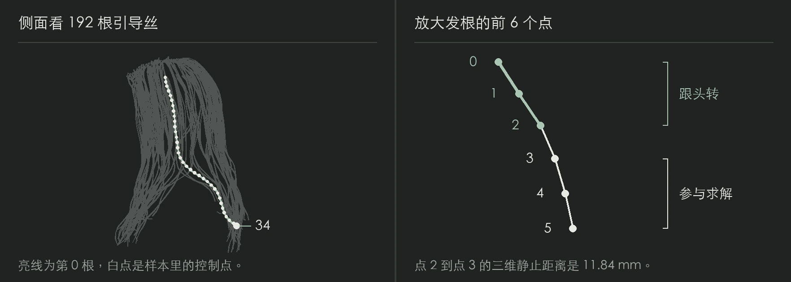

# GTA头发如何制作

[打开披发实验](../assets/hairlab/index.html?motion=2)

在上面的 Demo 里，把显示模式切到「游戏原始引导丝」。看耳朵后面那一束，画面里原本挤着一大片头发，切过去只剩几条线。转头时我们先算这些线怎么动，再用它们带动外面看得见的细丝。下面取披发样本里的第 0 根，顺着它从发根算到发梢。

## 哪些点拿来算物理

打开这份 groom，已经有 192 根引导丝，每根 35 个位置，编号 0 到 34。第 $g$ 根的第 $k$ 个点就在位置数组的第 $35g+k$ 项。顺着编号把相邻两点连起来，一根就有 34 段。网页直接读取这批点。样本保留了选好的引导丝，美术制作时具体怎么选的，光看这个文件推不出来。

每一段的原长各存一份。第 0 根沿折线量下来是 402.38 mm，点 2 到点 3 这一段是 11.84 mm。自己从一条连续曲线做类似的数据，可以先累加曲线的弧长，再按弧长取 35 个位置。读取现成样本时，按每对相邻点的实际距离建约束，就能保留原来的疏密和弯曲。

## 发根怎么蒙皮

第 0 根的点 0 长在头皮上。角色向右转头，这个点应该先跟头走。样本的骨骼表里只有一根 `BM_Head`。算它的蒙皮位置，要把点从绑定姿势变到头骨的局部坐标，再用这一帧的头骨矩阵送回去。记原位置为 $r$，绑定时的骨骼矩阵为 $B$，动画这一帧的矩阵为 $M(t)$。如果一个点有多根骨骼影响，就按骨骼权重 $\alpha_b$ 混合，权重之和为 1。

$$
\begin{bmatrix}\hat p(t)\\1\end{bmatrix}=\sum_b\alpha_b\,M_b(t)B_b^{-1}\begin{bmatrix}r\\1\end{bmatrix}.
$$

放到这束披发上，就是头骨这一项，权重为 1。网页把动作简化成绕竖轴转头，目标位置可以直接写成 $\hat p_i=R_y(\theta)r_i$。比如第 0 根的点 0 原来在 $(-63.17,675.29,29.39)$ mm，转 $+30°$ 后落在 $(-40.01,675.29,57.04)$ mm。绕竖轴转，高度还是 675.29 mm。

每个物理步都把点 0、1、2 放到各自的目标位置，连同上一时刻的位置一起更新。固定三点，发根伸出头皮的方向就跟着转。点 3 开始可以落后，耳边那束头发才甩得起来。整头一共有 576 个固定点，剩下 6,144 个点交给求解器。

## PBD 怎么把一段拉回原长

用点 2 和点 3 算一次。点 2 已经跟着头骨走了，点 3 先按惯性往前走。网页用带阻尼的 Verlet 算预测位置，$h=1/90$ 秒，$p_n-p_{n-1}$ 是上一物理步的位移。靠根的自由点先跟头转一部分，前后两个位置一起转。记转过来的位移为 $v$，只在它过长时沿原方向截短，记为 $v_{\rm lim}$。这个上限从靠根的约 6 mm 逐渐增加到梢部的 12 mm。加速度 $a$ 里有重力、侧风，还有一项把发束拉向当前的蒙皮姿态。靠近发根，这项拉力大一些。到了发梢，风和惯性更容易把它带走。

$$
p^*_{n+1}=p_n+0.94\,v_{\rm lim}+a h^2.
$$

现在量预测后的距离。假设点 3 被带到了离点 2 **15.00 mm** 的地方，这一段原长只有 **11.84 mm**，多出来 **3.16 mm**。取点 2 指向点 3 的单位向量 $n$，点 2 固定，直接让点 3 沿 $-n$ 退回 3.16 mm。这样用约束误差直接修正位置，就是这里的 PBD（Position Based Dynamics）。[PBD 原文](https://matthias-research.github.io/pages/publications/posBasedDyn.pdf)

$$
d=p_b-p_a,\qquad n=\frac{d}{\lVert d\rVert},\qquad C=\lVert d\rVert-L.
$$

再往下看点 3 和点 4。它俩都能动，网页把同一份误差分给两端，靠根的点移动 $+0.45Cn$，靠梢的点移动 $-0.55Cn$。压短时 $C<0$，移动方向就反过来。改完点 3 和点 4，刚修好的上一段又会差一点，所以同一个时间步沿整根来回扫五轮。这里的 45% 和 55% 只是这次段长修正的分摊，跟前面头骨的蒙皮权重各有各的用途。

## 转头时为什么有时会炸开

单根的段长约束只管前后两个点。假设耳朵边有两根并排的引导丝，一根从耳前滑过去，另一根跑到耳后。你把每一段都拉回原长，两根发梢照样可以跑得很远。旧版满风反复换向时，同一小簇里原本相隔不到半毫米的发梢就出现过这种分离。细丝跟着两边一起跑，画面上看着像整束突然炸开。

这次用上了资产里每簇三根引导丝的对应关系。取同簇三根的第 17 点，分别算它们偏离自己蒙皮目标的位移 $d_i=p_i-\hat p_i$。把三个位移取平均，每根向这个平均位移靠一半，再解各自的段长和碰撞。这样整簇仍然能甩出去，同一簇里的三根也能沿皮肤各自滑动。

$$
\bar d=\frac{d_1+d_2+d_3}{3},\qquad p_i\leftarrow p_i+0.5(\bar d-d_i).
$$

头部接触也要看整段。两个点都在皮肤外面，连线仍可能穿过耳廓。网页把节点变回头部局部坐标，用头模的皮肤三角形检查这条线段。碰到耳缘时，把发段移回表面外，再检查相邻段的长度。把一点从皮肤里推出去，有时一步就要挪好几毫米。要是把这段位移原样留给下一步的 Verlet，它又会向外飞一次。求解器会同步修正它记录的上一位置，削掉这部分额外的弹出速度。

我们把侧风拉满，在 −78° 和 +78° 之间反复换向，连续跑 10 秒。看一个物理步里跳得最远的那个引导丝发梢，旧版跳了 242.9 mm，改完是 26.4 mm。

## 一根细丝该跟哪几根引导丝

样本里还有 64 组发根索引，每组三根。读第一组拿到的是 72、73、74，它们是三条引导丝的编号。只在这种很窄的小簇里插，簇与簇之间容易留缝。网页先在静止姿态给每组算一条平均曲线，取它的点 0、5、15、34 和别组比较。根离得近、往同一侧长、下半段也挨得近的，排在前面。留下六组邻居，生成普通细丝时从本组挑一根，再从两个不同的邻组各挑一根。填发根空隙时也会只用两根。

比如一根细丝跟三条引导丝 $A,B,C$，给它三个非负权重 $w_A,w_B,w_C$，加起来是 1。引导丝解完以后，GPU 要画这根细丝的第 17 个点，就去读三条引导丝各自的第 17 个点。往下画第 18 个点，还是这三根、这三个权重，只换节点编号。

$$
q_k=w_Ag_{A,k}+w_Bg_{B,k}+w_Cg_{C,k}.
$$

先算这个加权位置。取 Demo 里编号为 1 的细丝，读到的三根引导丝是 158、167、155 号，权重约为 0.2014、0.2034、0.5952。只把 155 号的第 17 点向右挪 10 mm，算出来的插值中心就向右挪 5.95 mm。急转时三根引导丝有时会绕到头部两侧，这时再把插值中心限制在权重最大的引导丝附近。细丝碰到皮肤时，两条边沿同一条中心线一起修正，避免一侧被推出去，另一侧还留在原地，扯出一个长三角形。

把 Demo 的「渲染发丝」往左拉，可以看到头发变稀，底下参与求解的始终是那 192 根。

## GPU 模拟一步花多久

我们另外测了一份 GPU 求解器。它把引导点排成一张 35 列、192 行的纹理，一行对应一根引导丝。第一趟并行算每个点的蒙皮目标、预测位置和碰撞，第二趟沿每根引导丝从根到梢恢复段长。单人披发，连续跑 32 步，用总时间除以 32，12 组的中位数是每步 **0.04 毫秒出头**。上面这个交互 Demo 的 PBD 跑在 CPU，解完的引导点交给 GPU 插细丝。
